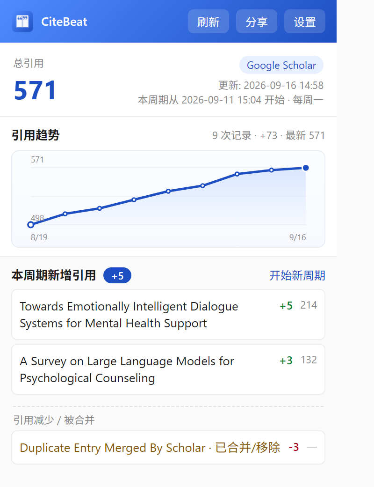
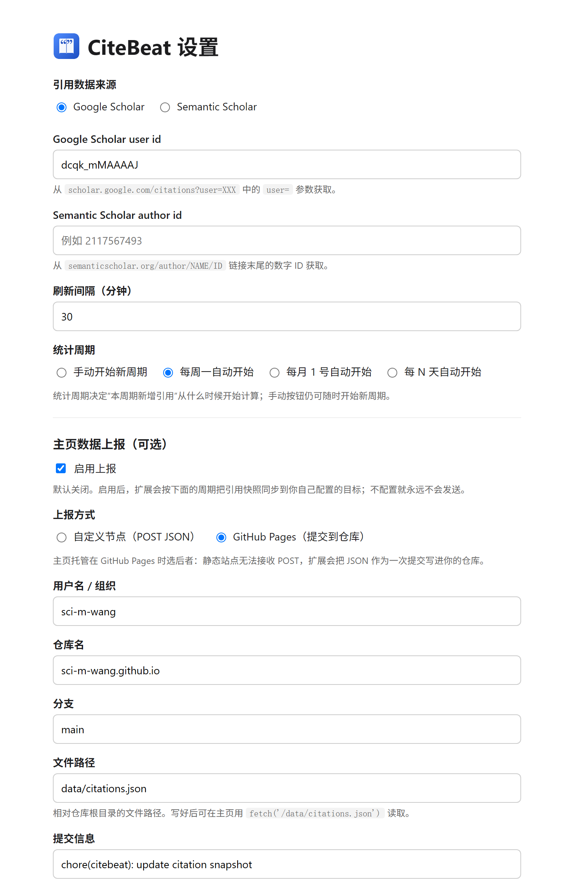

<div align="center">
  
  <h1>CiteBeat</h1>
  <p><em>听见你引用的节拍。</em></p>
</div>

<p align="center">
  <a href="https://github.com/MLNLP-World/CiteBeat/blob/main/manifest.json">
    
  </a>
  <a href="LICENSE">
    
  </a>
  <a href="https://github.com/MLNLP-World/CiteBeat/stargazers">
    
  </a>
  <a href="https://github.com/MLNLP-World/CiteBeat/network/members">
    
  </a>
  <a href="https://github.com/MLNLP-World/CiteBeat/issues">
    
  </a>
  <a href="https://github.com/MLNLP-World/CiteBeat/pulls">
    
  </a>
</p>

一个极简的浏览器扩展，定时获取你的 Google Scholar / Semantic Scholar 总引用数，并一键查看本周期内引用有增长的论文。

## 功能

- 🔄 **定时抓取**：后台按设定间隔（默认 30 分钟）自动刷新引用数据
- 🔁 **双数据源可切换**：支持 Google Scholar 和 Semantic Scholar，任选其一
- 🔢 **徽章显示总引用**：工具栏图标直接显示最新总引用数（自动简写为 `12.3k`）
- 📈 **本周期新增引用**：点击图标可查看当前统计周期内引用数发生增长的论文列表（每篇论文 `+N` 引用），按增量降序排列
- 🕹 **手动开始新周期**：随时可把当前状态设为新统计周期的起点，重新开始统计
- 📅 **自动统计周期**：可选择手动、每周一、每月 1 号或每 N 天自动开始新周期
- 🗂 **轻量历史缓存**：总引用或论文级变化发生时，在本地记录总量快照和 Top 论文变动摘要
- 📊 **引用趋势图**：弹窗内展示当前作者最近的总引用变化趋势
- 🖼 **一键分享图**：生成 1200×630 PNG，展示引用增长、趋势、Top 论文和 CiteBeat 项目入口
- 💽 **手动备份/恢复**：设置页可导出和导入本地数据备份，方便开发调试或迁移前保存历史
- 🔗 **可选主页上报**：把引用快照发送到你自己的节点，或直接提交到 GitHub Pages 仓库（默认关闭）
- 💾 **数据仅本地存储**：默认所有数据保存在浏览器本地 `chrome.storage.local`，不会上传到任何服务器

## 安装

### 开发者模式加载

1. 克隆本仓库：`git clone https://github.com/MLNLP-World/CiteBeat.git`
2. 在仓库目录运行 `./pack.sh`（会生成 `dist/unpacked/` 目录）
3. 打开 `chrome://extensions` 或 `edge://extensions`，启用"开发者模式"
4. 点"加载已解压的扩展程序"，选择 `dist/unpacked`
5. 首次安装会自动打开设置页

> 注意：不要直接加载仓库根目录。根目录下的 `_config.yml`（GitHub Pages 用）
> 以下划线开头，会被 Chromium 视为保留名并拒绝加载。`pack.sh` 会产出干净的扩展目录。
>
> 本地调试时尽量固定使用同一个 `dist/unpacked` 路径，并优先在扩展管理页点击 reload。
> 卸载重装或换目录加载可能导致 Chrome 分配不同扩展 ID，旧的 `chrome.storage.local`
> 数据不会自动迁移。需要保留历史时，请先在设置页导出备份。

### 从 Chrome Web Store 安装

_（待上架后补充链接）_

## 使用

1. 点击扩展图标或右键 → "选项"，打开设置页
2. 选择数据来源（Google Scholar 或 Semantic Scholar）
3. 填入对应的作者 ID：
   - **Google Scholar user id**：个人主页 URL `scholar.google.com/citations?user=XXX` 中的 `user=` 参数
   - **Semantic Scholar author id**：作者页 URL `semanticscholar.org/author/NAME/ID` 末尾的数字 ID
4. （可选）调整刷新间隔和统计周期
5. 保存后会自动开始抓取。点击工具栏图标查看弹窗

## 数据管理

- **导出备份**：设置页会下载一个 `citebeat-backup-*.json` 文件，包含设置、当前引用、统计周期和历史记录
- **导入备份**：手动选择 CiteBeat 备份文件后，会在确认后完整覆盖当前本地数据
- **隐私边界**：备份文件只在本机生成和读取，扩展不会把数据上传到任何服务器

## 分享图

- **生成入口**：弹窗中的"分享"按钮会打开分享页并生成 PNG 预览
- **图片内容**：包含 CiteBeat 标识、本周期引用变化、总引用、引用趋势、Top 论文和 GitHub 仓库二维码
- **降级展示**：趋势不足 2 条时显示 `Trend building`；没有 Top 论文时显示占位说明；未成功刷新过时提示先刷新
- **本地生成**：Canvas 和二维码都在浏览器本地生成，不调用外部图片或二维码服务

## 主页数据上报（可选）

用于把引用数据同步到你自己的个人主页。**默认关闭，不配置就永远不会发送。** 支持两种方式：

| 方式 | 适用场景 | 做法 |
|---|---|---|
| 自定义节点 | 主页有后端 / Serverless 函数 | POST `citation.snapshot` JSON |
| GitHub Pages | 主页是静态站点 | 通过 Contents API 把 JSON 提交进仓库 |

### 方式一：自定义节点

1. 设置页 → "主页数据上报" → 勾选启用 → 上报方式选"自定义节点"
2. 填写节点地址，例如 `https://example.com/api/citations`
3. 需要鉴权时选 Bearer Token 并填入，会以 `Authorization: Bearer <token>` 发送

```
POST <你的节点地址>
Content-Type: application/json
X-CiteBeat-Schema: citation.snapshot/1
Authorization: Bearer <token>   # 仅在选择 Bearer 时
```

节点返回 2xx 视为成功。

### 方式二：GitHub Pages

静态站点没有后端可以接收 POST，所以扩展改为**把 JSON 作为一次提交写进你的仓库**，GitHub Pages 重新部署后主页即可读到。

1. 上报方式选"GitHub Pages"
2. 填用户名/组织、仓库名、分支（默认 `main`）、文件路径（默认 `data/citations.json`）
3. 创建 Token：GitHub → Settings → Developer settings → **Fine-grained personal access token**
   - Repository access：只选这一个仓库
   - Permissions → Repository permissions → **Contents: Read and write**
   - 其它权限都不需要
4. 粘贴 Token → 点"测试" → 授权 `https://api.github.com/*`

扩展会先 `GET` 该文件拿 `sha`（不存在则创建），再 `PUT` 提交。若期间有其他提交导致 `409`，会重新取 `sha` 再试一次。

在主页里读取：

```js
const res = await fetch('/data/citations.json');
const snap = await res.json();
document.querySelector('#citations').textContent = snap.metrics.citations;
document.querySelector('#hindex').textContent = snap.metrics.hIndex;
```

> 提交会计入仓库历史。建议把上报周期设为 1 天或更长，避免频繁提交刷屏。

### 按钮

- **测试**：保存配置并立即发送一次，用于验证连通性与权限
- **立即发送**：忽略周期限制，马上推送一次
- **预览快照**：只在本地生成 JSON 预览，不发送任何数据
- **清除 Token**：删除当前模式下本地保存的凭据

### 载荷格式

```json
{
  "schema": "citation.snapshot",
  "schemaVersion": 1,
  "generatedAt": "2026-06-13T16:00:00.000Z",
  "generator": { "name": "CiteBeat", "version": "0.3.1" },
  "source": {
    "provider": "scholar",
    "authorId": "xxxxxxxx",
    "profileUrl": "https://scholar.google.com/citations?user=xxxxxxxx",
    "fetchedAt": "2026-06-13T15:58:00.000Z"
  },
  "metrics": { "citations": 571, "hIndex": 12, "i10Index": 15, "paperCount": 40 },
  "period": { "mode": "manual", "startedAt": "2026-06-01T00:00:00.000Z", "citationDelta": 8 },
  "papers": [
    { "id": "xxx", "title": "论文标题", "citations": 42, "delta": 2, "url": "https://..." }
  ],
  "trend": [ { "at": "2026-06-10T00:00:00.000Z", "citations": 563 } ]
}
```

超时 15 秒，失败最多重试 3 次（仅对超时、429 和 5xx 重试）。

### 隐私边界

- 目标完全由你填写，扩展不内置任何服务器
- `optional_host_permissions` 声明为通配形式，因为无法预知你的域名；实际授权由浏览器逐域名弹窗确认
- Bearer Token 和 GitHub Token 各自单独存储，**都不会写入导出的备份文件**
- 可随时关闭上报、清除 Token，或在浏览器扩展设置里撤销域名授权

## 弹窗界面

- **总引用**：来自当前数据源的最新总数
- **引用趋势**：基于当前作者的本地历史快照绘制最近趋势；少于 2 条历史时显示空状态
- **本周期新增引用 +N**：自本周期起点以来所有论文引用增长之和
- **论文列表**：只展示当前统计周期内引用数增加的论文，显示 `+N` 增量与当前总引用，点击标题直达论文页
- **引用减少 / 被合并**：单独列出引用下降或被数据源合并移除的论文，帮助解释总量差异
- **统计周期**：显示当前周期起点和模式；自动模式会在下一次成功刷新时开启新周期
- **开始新周期**：把当前状态设为新统计周期的起点，自动模式下也可手动使用
- **刷新**：立刻触发一次抓取，不必等下一次定时
- **分享**：生成本地 PNG 分享图，可下载后发布到社交平台或 README

## 权限说明

| 权限 | 用途 |
|---|---|
| `alarms` | 创建周期性刷新任务与可选的上报检查 |
| `storage` | 本地保存作者 ID、引用快照、统计周期起点、历史摘要和备份恢复数据 |
| `https://scholar.google.com/*` | 抓取本人公开的 Google Scholar 个人页 |
| `https://api.semanticscholar.org/*` | 调用 Semantic Scholar 官方 Graph API |
| `optional_host_permissions` | 仅在启用上报并授权后，向你自填的节点地址发送快照 |

扩展不会读取其他任何页面，不会与第三方服务器通信，也不会收集任何用户识别信息。
唯一的对外发送是你主动配置并授权的上报节点。详见 [PRIVACY.md](PRIVACY.md)。

## 截图




## 已知限制

- Google Scholar 在高频抓取下可能会触发临时验证码，建议刷新间隔 ≥ 15 分钟
- Semantic Scholar 作者页与 API 口径偶有差异，已自动取二者较大值
- Google Scholar 论文列表通过分页抓取；若页面结构变化或被临时限制访问，论文级增长可能暂时无法完整归因

## 参与贡献

欢迎 [issue](https://github.com/MLNLP-World/CiteBeat/issues) / [PR](https://github.com/MLNLP-World/CiteBeat/pulls)。小工具、轻维护，任何改进都欢迎：

- 报 bug：issue 附上数据源、作者 ID（若方便）、service worker console 的日志
- 提新功能前，先开 issue 聊一下思路

## 致谢

本项目由 [MLNLP 社区](https://github.com/MLNLP-World) 维护。

### 发起人&组织者

<a href="https://github.com/sci-m-wang">  </a>

### 贡献者列表

<a href="https://github.com/sci-m-wang">  </a>
&nbsp;
<a href="https://github.com/ZhangYiqun018">  </a>
&nbsp;
<a href="https://github.com/lumen-coder">  </a>

## 许可证

基于 [SymPro License](LICENSE) 开源 © 2026 KinaMind。

SymPro License 继承 MIT License 的全部条款，并在此基础上补充人-Agent 协作的归属与溯源规范
（[SymPro 0.1](https://github.com/kinamind/SymPro)），详见仓库内 `.sympro/` 目录。
